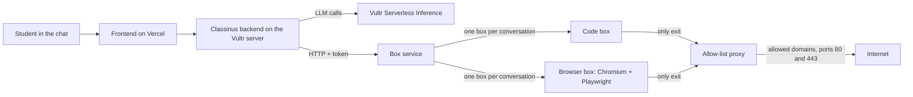

# Classinus x Vultr: Blast Radius Zero

Submission for the **Vultr Agent Rush** hackathon (lablab.ai), track 1, **Blast Radius Zero**.

Classinus is an AI assistant with a chat interface. For this hackathon, its agent can run code and drive a real web browser, and both happen **inside disposable, locked-down Docker boxes on a Vultr server**. If the agent (or a page it reads) goes wrong, the damage stays inside a box that has no secrets, no open network, and a short lifetime.

- Demo (public URL): _to be added before submission_
- Video (under 5 minutes): _to be added before submission_
- Slides (PDF): _to be added before submission_

## How Vultr is used

| Vultr service | What it does here |
| --- | --- |
| **Cloud Compute** (Frankfurt) | The control center. One server runs Coolify, the Classinus backend, and the box service that creates and destroys the isolated boxes. |
| **Serverless Inference** (`https://api.vultrinference.com/v1`, OpenAI compatible) | The LLM calls of the agent. Models served only by Vultr in this project: GLM 5.3 and GLM 5.3 Flash (Z.ai), Qwen 3.8 27B and Qwen 3.8 Flash Next (Alibaba), Nemotron Nano Omni 30B (NVIDIA), Muse Glimmer 30B (Meta). DeepSeek also goes through Vultr, with a fallback route if Vultr fails. The Vultr-only models have no other route: an error from Vultr is shown as is. |

The frontend stays on Vercel, which the organizers accepted. Authentication and data stay on Supabase.

## Architecture



Only the box service touches the Docker socket. The backend talks to it over HTTP with a token.

## What is enforced on every box

| Protection | How |
| --- | --- |
| Isolated process | One Docker container per conversation, non-root user (1000), all Linux capabilities dropped, `no-new-privileges`, read-only filesystem |
| Memory, CPU, processes | `--memory`, no swap, `--cpus`, `--pids-limit` (configurable) |
| Disk | Capped tmpfs volume |
| Time | Direct commands are killed after 60 seconds (exit code 124) |
| No secrets inside | The box only receives the proxy variables, never a Classinus or Vultr key |
| Closed network by default | Internal Docker network, no route to the Internet |
| Allow-list exit | The only way out is the service proxy, domain by domain, ports 80 and 443, public addresses only (no internal network, no `169.254.x.x`) |
| Destruction | Deleting a box removes the container and its volume. Pausing stops it and keeps the files |

Details and deployment steps: [`boites_service/README.md`](boites_service/README.md).

## Human approval before the final browser action

The browser box can open pages, click, type and take screenshots. A vision model checks each screenshot. Any final action (send, pay, delete, publish, confirm) goes through a single action, `submit`, which **always asks the user for approval**, every time. There is no "always allow" option. Opening a new website also requires the user to approve network access for that domain.

Content shown by a web page is treated as untrusted data, never as an instruction.

## Containment demo

From inside a code box, the agent runs a program that tries to reach a site that is not on the allow-list and the internal metadata address:

```
https://example.org BLOCKED: URLError <urlopen error Tunnel connection failed: 403 Forbidden>
http://169.254.169.254/latest/meta-data/ BLOCKED: HTTPError HTTP Error 403: Forbidden
```

Both requests are refused by the proxy, not by chance.

## What we tested in the app

- The model calls the code tool and reports the real result (user 1000, not root).
- The model reads an unpredictable value (a random UUID) from a browser screenshot.
- The final browser action waits for approval, and a refusal really prevents the submission.
- A program that sleeps 90 seconds is killed by the time limit, and its last line never prints.
- Unauthorized sites and internal addresses are refused.

## Known limits

- Files live in memory (tmpfs) while the server runs. A server restart erases the workspaces.
- Chromium runs with its own sandbox disabled, because the box has no Linux capability. The box itself is the isolation layer.
- Jobs started in the background (`run_background`) are not cut at 60 seconds. An inactive box is paused after a period of inactivity (5 minutes by default), and its files are kept.

## Run it

Backend variables (never in the code):

```
EXECUTION_CODE_FOURNISSEUR=docker
BOITES_URL=https://<address of the box service>
BOITES_TOKEN=<long random token, same as the box service>
VULTR_INFERENCE_API_KEY=<Vultr Serverless Inference key>
```

Without `EXECUTION_CODE_FOURNISSEUR=docker`, the backend keeps using its previous code sandbox, so the production app is not affected. Deployment of the box service on Coolify is described in [`boites_service/README.md`](boites_service/README.md).

Offline tests: `python3 -m unittest test_boites_isolees test_boites_service`

The frontend lives in [classinus-frontend](https://github.com/petitboura/classinus-frontend).
