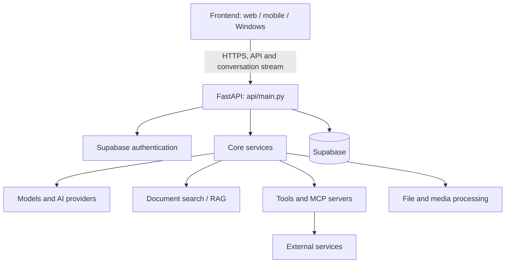

# Backend architecture

[English version] · [Français](ARCHITECTURE.fr.md)

[English version] · [Français](ARCHITECTURE.fr.md)

## Service role

This repository contains the Classinus backend: a FastAPI API, AI engines, and application services. The web frontend and installed applications are maintained in [classinus-frontend](https://github.com/petitboura/classinus-frontend).

## Overview

## Repository structure

| Path | Responsibility |
|---|---|
| `api/` | HTTP routes, authentication dependencies, and application assembly |
| `core/` | chat orchestration, business logic, models, tools, RAG, and internal services |
| `connexions/` | integrations and connection flows for third-party services |
| `indexers/` | document and content indexing |
| `migrations/` | SQL migrations to apply to Supabase |
| `scripts/` | operational tasks, synchronization, and verification |
| `skills_plateforme/` | official skills provided by Classinus |
| `tests/` and `test_*.py` | unit, integration, and regression tests |

## Chat request lifecycle

1. The frontend sends the request to the API.
2. Authentication dependencies validate the user.
3. The chat layer prepares the context and prompt.
4. The engine selects the generation path and, when applicable, the authorized tools.
5. Results are sent to the frontend and the exchange is persisted.

The backend also runs background tasks and specialized services that are not executed directly within every request.

## Data and services

Supabase provides authentication, the PostgreSQL database, and the storage services used by the project. Privileged operations use backend server credentials. File, generation, and connector engines rely on external providers configured through environment variables.

See [Data and security](DONNEES_ET_SECURITE.md), [AI and RAG](IA_ET_RAG.md), and [MCP and connectors](MCP_ET_CONNECTEURS.md) for details.
