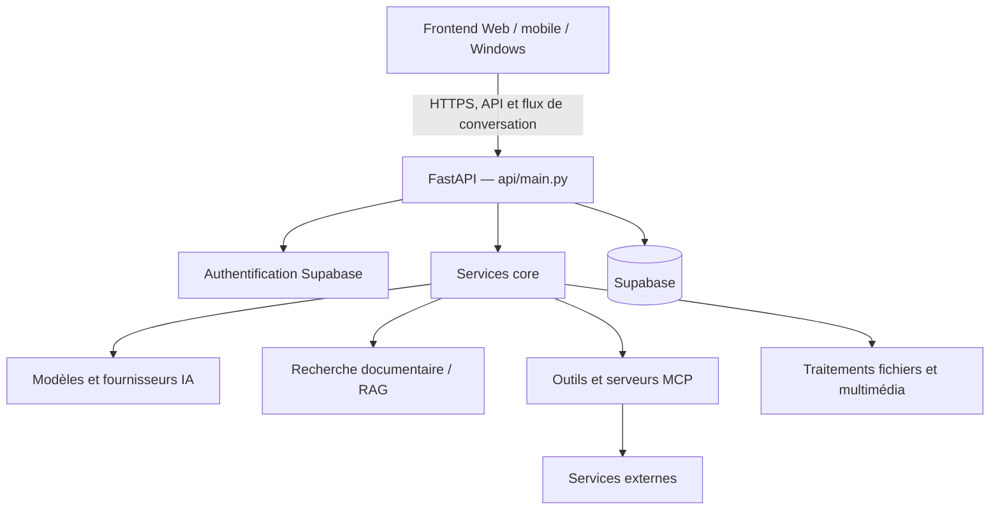

# Architecture du backend

## Rôle du service

Le dépôt contient le backend de Classinus : une API FastAPI, les moteurs IA et les services applicatifs. Le frontend Web et les applications installées sont maintenus dans [classinus-frontend](https://github.com/petitboura/classinus-frontend).

## Vue d’ensemble

## Organisation du dépôt

| Chemin | Responsabilité |
|---|---|
| `api/` | routes HTTP, dépendances d’authentification et assemblage de l’application |
| `core/` | orchestration du chat, logique métier, modèles, outils, RAG et services internes |
| `connexions/` | intégrations et flux de connexion de services tiers |
| `indexers/` | indexation de documents et de contenus |
| `migrations/` | migrations SQL à appliquer à Supabase |
| `scripts/` | tâches opératoires, synchronisations et vérifications |
| `skills_plateforme/` | skills officiels fournis par Classinus |
| `tests/` et `test_*.py` | tests unitaires, d’intégration et de non-régression |

## Cycle d’une requête de chat

1. Le frontend envoie la requête à l’API.
2. Les dépendances d’authentification valident l’utilisateur.
3. La couche de chat prépare le contexte et le prompt.
4. Le moteur choisit le chemin de génération et, selon le cas, les outils autorisés.
5. Les résultats sont transmis au frontend et l’échange est persisté.

Le backend comporte aussi des tâches de fond et des services spécialisés qui ne sont pas exécutés directement dans chaque requête.

## Données et services

Supabase fournit l’authentification, la base PostgreSQL et les espaces de stockage employés par le projet. Les opérations privilégiées utilisent les identifiants serveur du backend. Les moteurs de fichiers, de génération et les connecteurs s’appuient sur des fournisseurs externes configurés par variables d’environnement.

Voir [Données et sécurité](DONNEES_ET_SECURITE.md), [IA et RAG](IA_ET_RAG.md) et [MCP et connecteurs](MCP_ET_CONNECTEURS.md) pour les détails.
